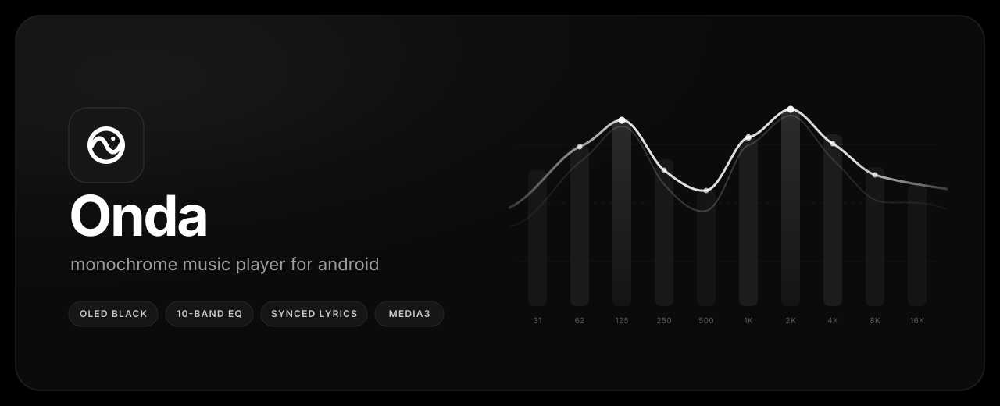

<div align="center">

  <sub>What is Onda? It is a fast, pure-black OLED music player for Android. Open source, local-first, no ads, and it does not collect your data. Still actively being built, so expect a few rough edges along the way.</sub>
  <br/>
<p align="center">
  <a href="https://github.com/DiemMyCodex/Onda-Music/releases">
    
  </a>
  <a href="https://github.com/DiemMyCodex/Onda-Music/stargazers">
    
  </a>
  <a href="https://github.com/DiemMyCodex/Onda-Music/network/members">
    
  </a>
  <a href="https://github.com/DiemMyCodex/Onda-Music/releases">
    
  </a>
  <a href="https://github.com/DiemMyCodex/Onda-Music/releases/latest">
    
  </a>
</p>
</div>

> [!NOTE]
> Onda is still under active development. If something crashes or feels off, opening an issue helps a lot.

---

## How to install

<p>
  <a href="https://github.com/DiemMyCodex/Onda-Music/releases/latest">
    
  </a>
  <a href="https://github.com/DiemMyCodex/Onda-Music/releases">
    
  </a>
</p>

1. Open the [latest release](https://github.com/DiemMyCodex/Onda-Music/releases/latest) on your phone.
2. Download the `.apk` file. Pick **arm64** for basically any modern Android phone (64-bit, Android 10+).
3. Tap the downloaded file and allow installs from your browser or file manager if Android asks (you can turn it back off right after).
4. Open Onda and start listening. No account or sign-in needed.

Updating works the same way: install the newer APK right over the old one and your library, playlists, and EQ profiles stay intact.

> [!TIP]
> Only download Onda from the Releases page of this repository. Random re-uploads or forwarded links could be modified.

---

## What is inside (`v1.2.9`)

- Pure `#000000` OLED monochrome look with squircle geometry, seamless black system splash into Acoustic Ignition launch choreography, smoked glass blur, optional AGSL artwork mesh, and opt-in **OLED Adaptive Accent** (high-contrast WCAG AA artwork tint with `#000000` locked surfaces).
- Pro-grade **32-bit Float Parametric EQ** (`31Hz` to `16kHz`) supporting `PCM_16BIT`, `PCM_24BIT`, `PCM_32BIT`, and `PCM_FLOAT` (so 24-bit FLAC never bypasses EQ), bundled offline **AutoEq** search across **2,287 headphone/IEM/TWS profiles** bound per audio output (Bluetooth, Wired, USB DAC, Speaker), real-time Media3/FFmpeg **Audio Signal Path Telemetry** badge (`FLAC · 24-bit/96kHz · USB DAC`), and per-session or global speed/pitch persistence.
- **Hedged Multi-Source Word-Timed Lyrics Engine** combining BetterLyrics (Apple Music TTML syllable timing), SimpMusic Lyrics, LRCLIB, NetEase JSON (native bilingual translations), and YouTube Music fallback, rendered at 120Hz across 4 selectable styles (`Onda Kinetic`, `Acoustic Wave`, `Clean Rise`, `Pure Sweep`) with bilingual subtitles and opt-in on-demand translation cached in Room.
- **Local-First Power Features:** pure-black `#000000` **Offline Listening Stats & Shareable OLED Recap** (7d / 30d / All Time, zero telemetry), pure-Kotlin **Local Audio Tag & Artwork Editor** (MP3 ID3v2.3/2.4, FLAC Vorbis Comment + `METADATA_BLOCK_PICTURE`, M4A/MP4 atoms with atomic temp-file replace via MediaStore/SAF), and opt-in (off by default) lightweight **Libre.fm / Last.fm Audioscrobbler v2.0** & **Discord Gateway Rich Presence**.
- 10 switchable Now Playing styles (`Poster`, `Flagship`, `Classic`, `Turntable`, `Video`, `iPod`, `Timeline`, `Lyrics`, `Bedside`, and `Bedside Tiles` with OLED burn-in pixel shift) plus portable ZIP backups and `momi-export-*.zip` migration.

---

## FAQ

Q - Do I need to log in? Is adding a cookie safe?

A - No account is needed to search, play music, read lyrics, or download tracks. Adding a YouTube Music cookie is completely optional and only used to read private playlists or personal shelves. Your cookie stays in private local storage on your phone. Onda has no account system and does not run any server, and the code is right here in this repo if you want to check how it works.

Q - Monochrome FLAC is not playing or fails to load

A - That usually means their upstream server is down or rate-limiting. Switch off Monochrome FLAC in Settings -> Sources & Link Import, or try another track or source.

Q - The app feels heavy or drains battery on an older phone

A - Turning off Smoked Glass Blur and Dynamic AGSL Mesh in Settings -> Now Playing & Motion, or switching Lyrics Animation Style to `Clean Rise` or `Pure Sweep`, helps right away.

Q - Can I bring my library over from MomiMusic or Mochy Music?

A - Yes. Export your `momi-export-*.zip` backup from that app and load it inside Onda under Settings -> Storage & Transfer.

Q - Does it work on Android 9 or older?

A - No, minimum supported version is Android 10 (API 29).

Q - Can I contribute or report a bug?

A - Sure, open an [issue](https://github.com/DiemMyCodex/Onda-Music/issues) or send a pull request.

---

## How to build it yourself

You only need this if you want to edit the code. If you just want the app, grab the APK from releases above.

### What you need

- A Mac, Linux, or Windows computer
- [Android Studio](https://developer.android.com/studio) (includes JDK 21 and the Android SDK)
- Android SDK 37
- A phone with USB debugging enabled, or an emulator

### Steps

```bash
git clone https://github.com/DiemMyCodex/Onda-Music.git
cd Onda-Music
```

1. Open the folder in Android Studio once and let Gradle finish syncing (or point `sdk.dir` in `local.properties` to your Android SDK).
2. Build the debug APK and install it over ADB:
   ```bash
   ./gradlew :app:assembleArm64Debug --no-daemon
   adb install -r app/build/outputs/apk/arm64/debug/app-arm64-debug.apk
   ```

Debug builds install side-by-side with `com.onda.music.debug` so they will not touch your normal Onda install.

| Command | What it does |
| --- | --- |
| `./gradlew :app:assembleArm64Debug` | builds the arm64 debug APK |
| `./gradlew :app:assembleArm64Release` | builds the minified arm64 release APK |
| `./gradlew testDebugUnitTest :app:testArm64DebugUnitTest` | runs JVM unit tests across all modules |

### Release signing (optional)

Onda builds fine without signing secrets by falling back to the local debug keystore. To sign a release build with your own keystore, set these environment variables before running `:app:assembleArm64Release`:

```bash
export ONDA_KEYSTORE_PATH=/path/to/release.jks
export ONDA_KEYSTORE_PASSWORD=...
export ONDA_KEY_ALIAS=...
export ONDA_KEY_PASSWORD=...
```

Never commit keystore files or passwords.

### If the build fails

- Weird Hilt or KSP `Unresolved reference` errors after pulling changes: delete module `build/` folders and run Gradle again.
- Wrong Java version: make sure Gradle is running on JDK 21.
- Still stuck? Open an [issue](https://github.com/DiemMyCodex/Onda-Music/issues) with the full compiler error.

---

## Disclaimer

Onda is an independent open-source project built for personal use, with no ads or monetization. Always support the artists you listen to directly.

- Onda is not affiliated with, endorsed by, or sponsored by YouTube, Google, Spotify, Apple, or Deezer. All names and brands belong to their respective owners.
- Onda does not host, store, or distribute any music on any server. Audio and lyrics come from third-party sources on demand or from files already stored on your device.
- You are responsible for how you use the app, the third-party services or proxies you configure, and keeping any personal cookies private.

---

## Projects and APIs behind Onda

- **Mochy Music** by [realidkroo](https://github.com/realidkroo/Mochy-Music) for UI inspiration and `momi-transfer v1` backup compatibility.
- **InnertubeX** ([Repository](https://github.com/MetrolistGroup/innertubex)) for YouTube Music InnerTube API access.
- **NewPipeExtractor** ([Repository](https://github.com/TeamNewPipe/NewPipeExtractor)) for stream extraction fallback.
- **Monochrome** ([Website](https://monochrome.st)) for lossless FLAC stream resolution.
- **BetterLyrics**, **SimpMusic Lyrics**, **LRCLIB** ([Website](https://lrclib.net/)), and **NetEase** for multi-source word-timed, line-synced, and bilingual lyrics.
- **AutoEq** ([Repository](https://github.com/jaakkopasanen/AutoEq)) for headphone and IEM parametric EQ measurements (bundled offline).
- **AndroidX Media3** and **Jellyfin Media3 FFmpeg Decoder** for the playback pipeline and codec support.

---

## Star History

<a href="https://www.star-history.com/?repos=DiemMyCodex%2FOnda-Music&type=date&legend=top-left">
  <picture>
    <source media="(prefers-color-scheme: dark)" srcset="https://api.star-history.com/chart?repos=DiemMyCodex/Onda-Music&type=date&theme=dark&legend=top-left" />
    <source media="(prefers-color-scheme: light)" srcset="https://api.star-history.com/chart?repos=DiemMyCodex/Onda-Music&type=date&legend=top-left" />
    
  </picture>
</a>
